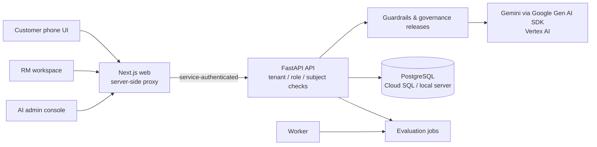

# NextRM

**An AI relationship copilot for banks.** NextRM turns what customers ask a bank assistant, and what bank-supplied prospect data shows, into sourced, reviewable signals that a relationship manager (RM) can act on, with consent and governance enforced by the server.

Theme: **BFSI: Intelligent Risk, Fraud & Financial Experiences** (Google Cloud AI Builder Cup 2026).

**Live demo:** <https://nextrm-web-551212450229.asia-southeast1.run.app/demo>. Choose a synthetic account: Dina (customer), Maya (RM), Arif (AI admin) or Intan (quality reviewer). The data is synthetic and persists in Cloud SQL; `scripts/gcp/reset-demo-data.sh --yes` restores it. The API scales to zero when idle, so the first request after a quiet period waits for a container start.

---

## The Problem

Bank relationship managers split their time between existing customers and new prospects. The context they need is scattered across chat transcripts, app activity, account snapshots and lead lists. Customers, meanwhile, want quick help without being sold to. NextRM connects the two sides without blurring them: customers get help first, and RMs get only what the customer shared or the bank is permitted to use, with the source attached.

---

## What It Does

| Surface | User | What It Delivers |
|---|---|---|
| **Customer Assistant** (`/customer/chat`) | Bank customer | Phone-layout Home with financial insights computed from the customer's own records: where the money went, safe-to-spend until payday, goal progress, credit card cost against savings, a snapshot of investment holdings, net worth and suggested next steps, plus recurring bills, income, idle cash, commitments, deposit maturity and ranked nudges. Multi-turn bank-assistant chat with New Chat and History; official RM/team contact from bank configuration. No in-app RM messaging. |
| **RM Retention** (`/workspace`, `/retention`, `/relationships/[id]`, `/follow-ups`) | Relationship manager | Home briefing, existing-customer signal queue, customer detail (needs, behavior, notes, history), reviewed follow-ups with due dates and outcomes. |
| **RM Acquisition** (`/acquisition`) | Relationship manager | Assigned prospect shortlist plus **Nearby businesses**: Google Maps with a server-side radius search over points of interest (synthetic dataset or Google Places), each place checked against the bank's customer records (phone/NPWP/email hash, name + distance). Existing customers are filtered out by default; possible matches need RM review; a place becomes a prospect only by explicit RM action. |
| **AI Governance & Quality** (`/settings/ai-quality`, `/settings/governance`, `/settings/assignments`) | Institution AI admin / quality reviewer | Trace monitoring, evaluation runs, rule editing with **draft → test → publish** releases pinned to later answers, and RM coverage/capacity. Configuration rights never grant conversation content; that needs a separate grant. |

---

## How AI Is Used

Gemini does three jobs, all through one adapter (`services/api/app/services/assistant/engine.py`, Google Gen AI SDK `google-genai`, Vertex AI with `NEXTRM_AI_PROVIDER=vertex` or the Gemini API with `NEXTRM_AI_PROVIDER=gemini`):

| Job | Endpoint | Grounding and Validation |
|---|---|---|
| **Customer banking assistant** | `POST /v1/rm/chat/{id}/turns` | Acts as a personal banking assistant: answers directly, connects the question to the customer's own validated figures (spending, goals, card debt, holdings, net worth), offers one or two practical options and returns two or three tappable follow-up questions. Only the insight cards that serve the question are read. Approved knowledge and the customer's own snapshot only; cited source IDs must exist; every number must match a validated value (amounts are shown as `IDR 1,150,000`); the extracted need must be an exact customer-message span; privacy routing is forced deterministically; follow-up suggestions with numbers, links or promises are dropped. Investment questions are answered from the customer's linked holdings and the bank's dated market note: the assistant explains but never recommends buying, selling or holding, never predicts, never states a risk tolerance, and offers a relationship-manager handoff for a suitability review. An answer that does so fails closed. |
| **RM pre-call brief** | `POST /v1/rm/parties/{id}/ai-brief` | Built from the deterministic relationship brief (customer statements, observed events, shared goals, human notes). Every talking point must cite a source in that brief; numbers must appear in the cited source; no URLs, approvals or guarantees. |
| **RM outreach draft** | `POST /v1/rm/follow-ups/{id}/ai-draft` | English email or phone script. A deterministic consent gate runs before the model (restricted customers only get service drafts). Draft only, never sent or saved; same citation and number checks. |

Customer nudge wording on the Home screen is also written by Gemini from validated insight cards; if the wording fails the number or promise checks, the card shows the validated deterministic wording labelled `DETERMINISTIC`.

- **Typed output:** JSON schema at temperature 0; every generation is audited with mode, model, prompt version, latency and cited source IDs, never the generated text.
- **No silent fallback:** if the selected Google provider is missing, times out or returns invalid output, the request fails visibly. Every answer is labelled `LIVE` or `SIMULATED`.
- **Deterministic guardrails own decisions:** access, consent, eligibility, privacy and unsafe-action rules run before and after the model. Calculators own arithmetic (Decimal, never the model). Customer and source text is treated as data, never as instructions.
- **Governed behavior:** institution admins change intent, response, insight and nudge rules through tested, versioned releases. Protected scope, privacy and safety guards cannot be removed by a rule or prompt.

### Customer questions the demo answers

Each answer is built from a deterministic calculator in `services/api/app/services/planning.py` (Decimal, no model arithmetic) and explained by Gemini. `./.venv/bin/python scripts/top10_questions.py --live --show` asks all ten as the demo customer and grades every answer.

| # | Customer question | Computed from | What the assistant does |
|---|---|---|---|
| 1 | Where is my money going and how can I stop overspending? | 30-day category spend, share, change, savings rate | Names the biggest and fastest-growing categories and offers a cap or review |
| 2 | How much can I safely spend or save this month? | Balance minus typical spending until payday, 30-day projection, monthly surplus | Gives the headroom until payday and flags a shortfall |
| 3 | How do I start investing with limited money? | Cash buffer, card debt, monthly surplus, approved education | Checks buffer and debt first, explains fund types, states the suitability boundary |
| 4 | Am I on track for my goals? | Required against planned monthly saving, projection, shortfall | Shows each goal, the monthly gap and the later-date alternative |
| 5 | Is my portfolio performing well? | Value, gain or loss, 30-day change, allocation, concentration | Explains the figures without buy, sell or hold advice and offers an RM review |
| 6 | Should I pay down debt, save more or invest? | Card interest against savings yield, cash left after repayment, minimum-payment trap | Puts the certain cost first and investing last, no product advice |
| 7 | Can I cut subscriptions or recurring costs? | Per-merchant monthly estimate, essential, variable or discretionary | Lists discretionary items with amounts; cancelling happens with the merchant |
| 8 | What should I do next? | Fixed-order rules: cash gap, debt, buffer, goals, spending, learning | Presents the first steps as options |
| 9 | How is my financial health and net worth trending? | Assets minus liabilities, 30-day change, buffer, savings rate, debt share | Shows separate measures, never a single score |
| 10 | Why did my investments drop and should I sell? | Holdings plus the bank's dated market note | Explains the move, says it cannot tell the customer to sell, lists the decision facts and offers an RM review |

---

## Architecture



Cloud target: separate Cloud Run services for web, API and worker; Vertex AI for Gemini; Cloud SQL for PostgreSQL; Secret Manager; Firebase Authentication for end-user identity. Deployment scripts are in `scripts/gcp/` and container files in `infra/`. See [docs/DEPLOY.md](docs/DEPLOY.md).

---

## Repository Layout

```
apps/web/            Next.js 14 + React + TypeScript frontend
services/api/        FastAPI API, SQLAlchemy models, Alembic migrations, tests
services/worker/     Evaluation job worker
data/synthetic/      Synthetic fixtures (customers, prospects, knowledge, evaluation cases)
infra/               Dockerfiles and Cloud Build configs
scripts/             Local launcher, seeding, type generation, checks, scripts/gcp deployment
docs/                Product, architecture, design, and deployment documentation
```

---

## Run Locally

Requirements: Python 3.11+, Node.js 20+, PostgreSQL 16+ binaries (Postgres.app or `brew install postgresql@17`). The project-local server needs no setup: `scripts/dev_db.sh` creates and starts it on demand.

```bash
python3 -m venv .venv
./.venv/bin/pip install -r requirements-dev.txt -r requirements-google.txt
npm --prefix apps/web ci
gcloud auth application-default login   # live Gemini; see "Use Gemini"
./scripts/start_local.sh          # production build; or ./scripts/dev_local.sh for hot reload
```

The launcher starts the project-local PostgreSQL (`scripts/dev_db.sh`, data in `runtime/postgres`), dumps any existing local database to `runtime/backups`, applies migrations, seeds synthetic data, then starts the API, worker and web on loopback. Open <http://localhost:3000/demo> and choose an account:

| Account | Role | Opens |
|---|---|---|
| **Dina** | Customer | Phone assistant and insights |
| **Maya** | RM | Home, existing customers, acquisition |
| **Arif** | Institution AI admin | Quality monitoring, governance, coverage |
| **Intan** | Quality reviewer | Quality monitoring with explicit content grant |

The `/demo` chooser exists only in synthetic demo mode and is rejected in production.

### Use Gemini

The quick start above already selects live Gemini. To choose another model or region:

```bash
GOOGLE_CLOUD_PROJECT=<project> GOOGLE_CLOUD_LOCATION=asia-southeast1 GEMINI_MODEL=gemini-3.5-flash ./scripts/start_local.sh
```

`start_local.sh` uses live Gemini on Vertex AI by default (`gemini-3.5-flash`, `asia-southeast1`, thinking `low`) with the project from `GOOGLE_CLOUD_PROJECT`, `GCP_PROJECT_ID` or `gcloud config`, after `gcloud auth application-default login`. It stops with an error when no project is set. For an offline run set `NEXTRM_AI_PROVIDER=local` explicitly; every answer is then labelled `Simulated`.

### Use Google Maps Platform

```bash
NEXTRM_POI_PROVIDER=google GOOGLE_MAPS_SERVER_KEY=<places-key> \
GOOGLE_MAPS_BROWSER_KEY=<maps-js-key> GOOGLE_MAPS_MAP_ID=<map-id> ./scripts/start_local.sh
```

Without a browser key the acquisition page says Google Maps is not configured and keeps the list, search and actions usable. With `NEXTRM_POI_PROVIDER=google` and no server key, nearby search returns HTTP 503 instead of silently using synthetic data.

---

## Checks

```bash
./scripts/check.sh        # only the checks affected by edits since the last passing run, in parallel
./scripts/check.sh --all  # everything, plus the production build and the end-to-end HTTP flow
./.venv/bin/pytest -q     # all API tests on 6 parallel workers; add -n0 for one process, e.g. -n0 -k name
```

Tests run on PostgreSQL, the production engine. A run applies the Alembic migrations and the synthetic seed once, clones that database per worker and wraps each test in a transaction that is rolled back, so the whole API suite takes about half a minute. `scripts/dev_db.sh gc` removes databases left behind by an interrupted run.

---

## Deploy the Public Demo to Google Cloud

```bash
GCP_PROJECT_ID=<project> GCP_REGION=asia-southeast1 GEMINI_MODEL=gemini-3.5-flash \
GEMINI_LOCATION=asia-southeast1 GEMINI_THINKING_LEVEL=low \
GOOGLE_MAPS_BROWSER_KEY=<maps-js-key> ./scripts/gcp/deploy-demo.sh
```

The first run enables the required APIs, creates Artifact Registry, two service accounts and the Cloud SQL instance (`scripts/gcp/provision-sql.sh`: PostgreSQL 17, daily backups, point-in-time recovery, deletion protection), grants the API account `roles/aiplatform.user` and `roles/cloudsql.client`, then deploys:

- `nextrm-api`: private Cloud Run service (only the web service account can invoke it), one to three instances sharing one Cloud SQL database. The Cloud Run job `nextrm-db-setup` migrates and seeds before a new API revision takes traffic; the API never migrates at startup, and conversations and RM requests persist across deploys. The evaluation worker runs beside the API (`scripts/gcp/demo-api-entrypoint.sh`).
- `nextrm-web`: public Cloud Run service with the `/demo` account chooser. It signs each API call with its Google service identity.

Later runs are fast: images are tagged by content hash, unchanged services are skipped, and the API and web pipelines run in parallel (web only 100 s, API only 90 s, already-built images 32 s; the original script took 377 s). Verify with `./.venv/bin/python scripts/gcp/smoke_demo.py <web-url>` and `./.venv/bin/python scripts/top10_questions.py --url <web-url>`, then restore pristine demo data with `scripts/gcp/reset-demo-data.sh --yes`. Cloud SQL bills hourly while it exists: [docs/DEPLOY.md](docs/DEPLOY.md) covers cost, backups, rollback and teardown.

The production path (`scripts/gcp/deploy.sh`) instead uses Firebase Authentication and disables the demo chooser.

---

## Status and Limits

- Bank customers, accounts, transactions, prospects, activity events and the default POI dataset are **synthetic**.
- NextRM prepares RM work only. Loan assessment, product opening, approvals, payments and reconciliation belong to the bank's other systems; product links are navigation, not completion.
- Outreach is draft-only. No message is sent to a customer or prospect.

---

## Documentation

- [docs/PRODUCT.md](docs/PRODUCT.md): Product requirements, personas, and operational boundaries
- [docs/ARCHITECTURE.md](docs/ARCHITECTURE.md): System components, active data model, API surface, AI adapter, and status
- [docs/DESIGN.md](docs/DESIGN.md): Design system, visual tokens, surface layouts, and accessibility
- [docs/DEPLOY.md](docs/DEPLOY.md): Local development, environment variables, demo deploy, and production path
- [AGENTS.md](AGENTS.md): Repository implementation contract and engineering rules
