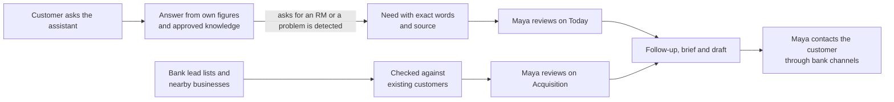
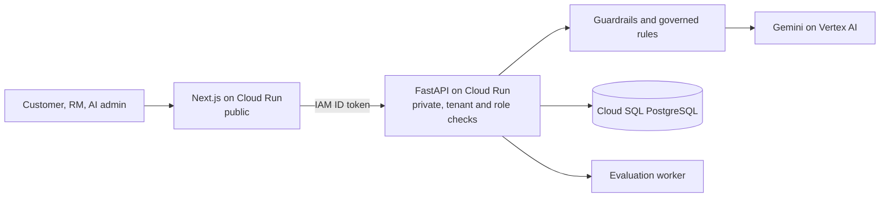

# NextRM

An AI relationship copilot for banks. Customers get straight answers from their bank's assistant, and their relationship manager (RM) sees what they asked for, in their own words, with the source attached.

[](https://nextjs.org)
[](https://fastapi.tiangolo.com)
[](https://cloud.google.com/vertex-ai)
[](https://cloud.google.com/run)
[](https://cloud.google.com/sql)

Built for the Google Cloud AI Builder Cup 2026, theme BFSI: Intelligent Risk, Fraud & Financial Experiences.

No sign-up: pick Dina (customer), Maya (RM) or Arif (AI admin), and switch between the customers Dina, Aditya and Nabila from the header. All data is synthetic and persists in Cloud SQL; `scripts/gcp/reset-demo-data.sh --yes` restores the starting state. The API scales to zero when idle, so the first request after a quiet period waits a few seconds for a container to start.

---

## The problem

Maya is a relationship manager at a retail bank. She looks after a book of existing customers and is also expected to bring in new ones. The context she needs is spread across chat transcripts, app activity, account snapshots and lead lists. Preparing for one good conversation means stitching those together by hand, so follow-ups go stale and the customer who asked for help last week waits.

Aditya banks with her. His question is simple: how much can he safely spend until payday? Bank chatbots tend to answer questions like his with a product pitch, and the outreach he receives rarely has anything to do with what he asked.

The bank sits between them with its own limits. It cannot let an AI invent a balance, promise an approval, or contact a customer who has said no to marketing.

## What NextRM does

NextRM links the two sides of that relationship. The customer's assistant answers from approved bank knowledge and the customer's own figures. Maya hears from the customer in two ways. A request is a short message the customer sends through a "Message Maya" form, choosing how and when to be contacted; the assistant suggests that form when a question needs a person, and Maya is expected to follow up. A signal is something NextRM notices without being asked: a need the customer mentioned while chatting with the assistant (under the bank's capture policy; saying "keep this private" opts a message out), app activity such as a failed transfer, or a change in their account data. Maya sees each signal with its source and decides whether to reach out. Either way she gets a sourced brief and a draft, and then calls, emails or meets the customer herself through the bank's own channels. NextRM never sends a message on its own, and there is no RM chat inside the app.

Prospects take a parallel path. Bank lead lists and businesses near Maya's area are checked against existing customers first, so she never cold-calls someone who already banks with her.



---

## For customers

The customer assistant is meant to live inside the bank's own mobile banking app, or any other app where the bank already serves its customers. Customers keep the app they trust, and the bank adds the assistant and its Home screen to it. The API identifies the customer from a verified sign-in token, and the assistant reads only that customer's records.

The demo at `/customer/chat` shows the assistant in a phone frame that stands in for a bank's app. It has a chat and a Home screen.

The chat keeps several conversations with their history. It answers questions about savings, deposits, cards, payments, loans, investing basics, merchant services and privacy from the bank's approved knowledge, and shows which sources it used. Passwords, PINs, OTPs, CVVs and card numbers are removed before anything is stored or sent to the model.

Home shows spending by category, safe to spend until payday, goal progress, card interest against savings yield, linked investments and net worth. Every figure is computed in code with `Decimal` from the customer's own records. When data is missing the screen says so instead of showing zero.

The assistant handles the ten money questions customers ask most:

| Customer asks | Answer uses | Where it stops |
|---|---|---|
| Where is my money going? | 30-day spend by category, share and change | Suggests a cap, does not set a budget |
| How much can I safely spend this month? | Balance and typical spending until payday | A snapshot, not a live balance |
| How do I start investing with little money? | Cash buffer, card debt, monthly surplus | No product recommendation |
| Am I on track for my goals? | Target, saved amount, date, monthly saving | Goals are set by the customer |
| Is my portfolio doing well? | Holdings, gain or loss, 30-day change, concentration | No buy, sell or hold advice |
| Pay down debt, save or invest? | Card rate, minimum payment, savings yield | No product advice |
| Can I cut recurring costs? | Monthly estimate per merchant | Cancelling happens with the merchant |
| What should I do next? | Fixed-order rules over the answers above | Options only, nothing is executed |
| How is my financial health? | Assets, liabilities, buffer months, savings rate | Separate measures, never one score |
| Why did my investments drop? | Holdings and the bank's dated market note | No timing or prediction; offers an RM review |

Suggestions come from twelve fixed families and are ordered care first: service problems, then guidance, education, recognition, and commercial offers last. The app shows at most three at a time. The customer can explore one, ask for their RM, dismiss it, snooze the topic, or opt out. Saying something like "stop selling" switches off commercial suggestions straight away, and service help keeps working.

Asking for the RM works like a light ticket. The customer taps Message Maya (on Home, or under an answer where the assistant suggests it, with their question already filled in), writes what they need, and picks how Maya should reach them (phone call, video call, branch meeting or email) and when (morning, afternoon or any time). Home lists each request with three steps: sent, Maya contacts you, done. Once Maya plans the follow-up, the customer sees her date ("Maya plans to call you by 21 Oct"). Signals NextRM noticed on its own are not requests, so they never appear in this list. The conversation itself happens on the phone, by email or at the branch.

When a customer wants personal investment advice, the assistant does not give it and suggests messaging their RM instead. The contact sheet lists only the channels the bank has configured.

## For relationship managers

Maya's workspace starts on Today (`/workspace`). Needs are grouped care first under Customer has a problem, Ready to talk, Asked for you (messages the customer sent her, which she should answer), and Spotted for you (signals from chat, app activity or account data that the customer has not asked about). Each one shows what happened, what it means and the next step, with the customer's own words. A blocked card always sits above a sales opportunity.

Opening a customer (`/relationships/[id]`) starts on their open needs, grouped care first. Each need is one row with its step (to check, plan follow-up, follow-up in progress); opening it shows the customer's words, how they want to be reached, and the one action that moves it forward. Done and dismissed needs fold away. The Overview tab holds the snapshot and the pre-call brief from Gemini, which lists talking points, questions to ask and cautions, each citing the record it came from.

Follow-ups (`/follow-ups`) move through planned, in progress, done and cancelled, with snooze and a recorded outcome. For each one Maya can ask for an email or a phone script. A consent check runs before the model is called, and the result is a draft for her to use, never a sent message. Marking a follow-up done records her task; opening a deposit or loan still happens in the bank's own systems.

Acquisition (`/acquisition`) puts prospects from bank imports and businesses around the chosen area into one list and one map. They are grouped by what Maya should do next: Ready to talk, To check, New nearby, In follow-up, and Not for now. Each business is matched against existing customers before it can become a prospect. Her device location is used only when she clicks Use my location, and it is never sent to the server.

Pulse (`/pulse`) counts open review items, urgent service cases and overdue follow-ups.

## For the bank

Arif, the institution's AI administrator, controls how the assistant behaves. In Governance (`/settings/governance`) he maps customer questions to approved knowledge and allowed responses. Changes go through draft, test and publish, and a draft must pass its regression suite before it can be published. Each chat turn records the release it ran under, so any answer can be traced to the rules in force at the time.

Coverage (`/settings/assignments`) sets dedicated RMs, a shared service pool and digital-first routing, with limits on book size. AI quality (`/settings/ai-quality`) shows traces, evaluation runs, latency and error rates.

Arif's quality view shows traces without the conversation text. Reading what a customer actually wrote needs a separate quality reviewer role with an explicit, time-limited grant. Every bank is a separate tenant, and the API enforces that on every request.

---

## Try it in 2 minutes

| Step | Enter as | Do this | You see |
|---|---|---|---|
| 1 | Aditya (customer) | Open Chats, tap "How much can I safely spend until payday?" | An answer built from his own balance and spending, with sources and a `LIVE` or `SIMULATED` label |
| 2 | Maya (RM) | On Today, open Aditya's term-deposit need under "Asked for you". Click Looks right, then Prepare follow-up | His exact words, a 3-step progress bar, and a follow-up draft. Nothing is sent |
| 3 | Maya (RM) | Open Acquisition. Check Ready to talk, then New nearby. Try Use my location | Assigned prospects and nearby businesses in one list and one map, each business checked against existing customers |
| 4 | Arif (AI admin) | Open Governance. Edit a rule, test it, publish it | Versioned rule releases that later answers are pinned to |

## Demo accounts

| Account | Role | Story | Cannot see |
|---|---|---|---|
| Dina Rahma | Customer | Teacher saving for school fees; a loan application hit an error in the app | RM notes, other customers |
| Aditya Pratama | Customer | Engineer with a diversified portfolio; a term deposit matures soon | RM notes, other customers |
| Nabila Aulia | Customer | Freelance designer with variable income, waiting for a new debit card | RM notes, other customers |
| Maya Putri | Relationship manager | Existing relationships, prospects and follow-ups | Customer chats, customer preferences, AI quality data |
| Arif | AI administrator | Governance releases, coverage and AI monitoring | Raw conversations without a quality grant |

Switch between Dina, Aditya and Nabila from the header at any time.

---

## How Gemini is used

One adapter, [`engine.py`](services/api/app/services/assistant/engine.py), calls Gemini (`gemini-3.5-flash`) on Vertex AI through the Google Gen AI SDK.

| Job | Grounded in |
|---|---|
| Customer banking answers | Approved bank knowledge and the customer's own validated figures |
| RM pre-call brief | The deterministic relationship brief; every point cites a source |
| RM outreach draft (email or phone script) | The follow-up and its sources; a consent check runs before the model |

Every answer passes the same checks:

- Each figure in an answer must appear in a cited source. Money math runs in code with `Decimal`, never in the model.
- Each cited ID must be an approved source, and an extracted need must quote the customer exactly.
- Promises such as "approved" or "guaranteed" are rejected, unknown URLs are blocked, and credentials are redacted before storage.
- Output is structured, at temperature 0. If Gemini fails, the request fails visibly, and every answer is labelled `LIVE` or `SIMULATED`.
- Customers with restricted consent get no sales suggestions, and outreach stays a draft.

## Architecture



| Layer | Technology | Purpose |
|---|---|---|
| Web | Next.js 14, React, TypeScript | Customer app, RM workspace, admin settings |
| Maps | Google Maps JavaScript API | Acquisition map |
| API | FastAPI, SQLAlchemy, Alembic, Pydantic | Tenant and role checks, guardrails, typed contracts |
| AI | Gemini via `google-genai` on Vertex AI | Answers, briefs and drafts |
| Data | Cloud SQL for PostgreSQL 17, Secret Manager | Records, audit trail, credentials |
| Hosting | Cloud Run (web, API, migration job), Artifact Registry, Cloud Build | Separate public web and private API services |

## Project structure

```
├── apps/web/src/
│   ├── app/
│   │   ├── (workspace)/customer/chat/    # Demo customer app: chat and Home in a phone frame
│   │   ├── (workspace)/workspace/        # RM Today desk
│   │   ├── (workspace)/relationships/    # Customer profile and pre-call brief
│   │   ├── (workspace)/follow-ups/       # Follow-ups and outreach drafts
│   │   ├── (workspace)/acquisition/      # Prospects and nearby businesses
│   │   ├── (workspace)/settings/         # Governance, AI quality, assignments
│   │   └── demo/                         # Demo account picker
│   ├── components/rm/                    # Workspace and customer components
│   └── lib/                              # API client, needs and opportunity grouping, generated types
├── services/
│   ├── api/app/
│   │   ├── routers/                      # HTTP endpoints by area
│   │   ├── services/assistant/engine.py  # The single Gemini adapter
│   │   ├── services/                     # Insights, customer matching, places, governance
│   │   └── models/, schemas/             # Database tables and typed contracts
│   ├── api/migrations/                   # Alembic migrations
│   ├── api/tests/                        # API test suite
│   └── worker/                           # Evaluation worker
├── data/synthetic/                       # Synthetic customers, knowledge, places, import example
├── infra/                                # Dockerfiles and Cloud Build configs
├── scripts/                              # Local start, seeding, UI tests, HTTP validation
│   └── gcp/                              # Provisioning and deployment
└── docs/                                 # Product, architecture, design, deploy
```

---

## Run locally

Needs Python 3.11+, Node.js 20+ and PostgreSQL 16+ binaries.

```bash
python3 -m venv .venv
./.venv/bin/pip install -r requirements-dev.txt -r requirements-google.txt
npm --prefix apps/web ci
NEXTRM_AI_PROVIDER=local ./scripts/start_local.sh   # offline; answers labelled SIMULATED
```

Open <http://localhost:3000/demo>. For live Gemini, run `gcloud auth application-default login` and drop `NEXTRM_AI_PROVIDER=local`. For hot reload while developing, add `NEXTRM_WEB_MODE=dev`. Deploying to Google Cloud is covered in [docs/DEPLOY.md](docs/DEPLOY.md).

## Verify

```bash
./.venv/bin/pytest -q                              # 332 API tests on PostgreSQL
./.venv/bin/python scripts/validate_account_http.py  # 151 end-to-end HTTP checks
./.venv/bin/python scripts/top10_questions.py --live --show  # top 10 customer questions, graded
```

## Scope

All customers, accounts, transactions, prospects and places are synthetic. NextRM prepares the RM's work; loans, approvals, payments and account opening stay in the bank's own systems. No message is ever sent to a customer, because outreach is a draft for the RM.

## Documentation

| File | Covers |
|---|---|
| [docs/PRODUCT.md](docs/PRODUCT.md) | Product requirements, personas, and operational boundaries |
| [docs/ARCHITECTURE.md](docs/ARCHITECTURE.md) | System components, active data model, API surface, AI adapter, and status |
| [docs/DESIGN.md](docs/DESIGN.md) | Design system, visual tokens, surface layouts, and accessibility |
| [docs/DEPLOY.md](docs/DEPLOY.md) | Local development, environment variables, demo deploy, and production path |
| [AGENTS.md](AGENTS.md) | Repository implementation contract and engineering rules |
