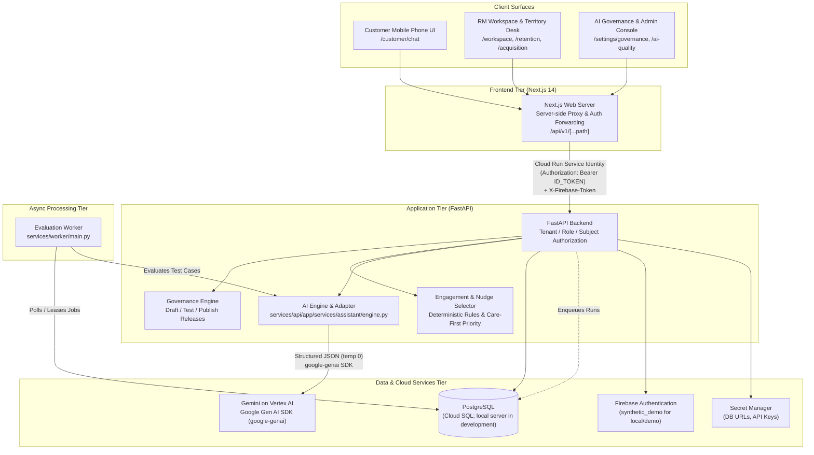

# NextRM — System Architecture

NextRM is structured as a modular, cloud-ready relationship copilot designed for banking institutions. The architecture separates public customer self-service, authenticated relationship manager (RM) workspaces, administrative governance, and private AI inference while enforcing tenant isolation and deterministic safety guardrails.

---

## 1. System Components and Top-Level Architecture

The system consists of five primary runtime components:



### Component Roles
1. **Next.js Web Application (`apps/web`):**
   - Built on Next.js 14 (React 18, TypeScript, Tailwind CSS).
   - Serves customer phone-frame chat, RM retention/acquisition dashboards, 3D territory visualization, and governance settings.
   - Operates a server-side route proxy (`/api/v1/[...path]`) that intercepts browser requests, validates local or Firebase identity, signs the outbound request using Google Cloud Run service identity, and forwards it to the private API.
2. **FastAPI Application Backend (`services/api`):**
   - High-performance asynchronous API built with FastAPI, Pydantic, and SQLAlchemy.
   - Enforces multi-tenant isolation, role checks (`CUSTOMER`, `RM`, `INSTITUTION_AI_ADMIN`, `QUALITY_REVIEWER`), and subject boundaries.
   - Houses deterministic engagement rules, signal deduplication, and the AI assistant engine.
3. **AI Adapter & Engine (`services/api/app/services/assistant/engine.py`):**
   - Single integration point for all model operations using the official Google Gen AI SDK (`google-genai`).
   - Executes typed structured generation against Gemini with deterministic pre- and post-generation validators.
4. **Evaluation Worker (`services/worker/main.py`):**
   - Standalone worker service processing batch evaluation runs asynchronously without degrading interactive customer turn latency.
5. **Persistence Tier:**
   - Relational database: PostgreSQL everywhere. Cloud SQL (Enterprise edition, PostgreSQL 17, automated backups and point-in-time recovery) backs the public demo and production; development and tests use a project-local server (`scripts/dev_db.sh`). Schema changes are Alembic migrations run by a Cloud Run Job (`nextrm-db-setup`), never at API startup. The API connects through the built-in Cloud SQL connector with a bounded pool per instance (`DB_POOL_SIZE`, `DB_MAX_OVERFLOW`), so several API instances can share one database.

---

## 2. Data Model Overview

The database migration history contains earlier tables that the app no longer uses. The active NextRM domain is modeled across 26 dedicated `rm_*` tables, grouped by functional domain:

| Domain | Table Name | Entity & Purpose |
|---|---|---|
| **Parties & Contacts** | `rm_parties` | Represents individuals (`PERSON`) and corporate entities (`ORGANIZATION`). Stores relationship type, owner ID, tenant ID, and contact consent (`ALLOWED` vs `RESTRICTED`). |
| | `rm_contacts` | Contact and governance links between organizations and individuals (e.g., director, authorized officer, finance contact). Prevents personal-account access from commercial roles. |
| **Sources & Knowledge** | `rm_sources` | Ingested source documents, bank knowledge entries, customer financial snapshots, and candidate prospect files. Retains content hash, mode (`LIVE`/`SIMULATED`), and provenance metadata. |
| **Prospects & Coverage** | `rm_prospects` | Candidate acquisition leads. Stores entity references, source links, assignment state (`ASSIGNED`, `HELD`), disposition, why-now rationale, and locality coordinates. |
| | `rm_customer_coverage` | Defines relationship coverage mode (`DEDICATED`, `SHARED`, `DIGITAL`), assigned RM ID, and shared pool association. |
| | `rm_capacity` | Configures per-RM workload limits: dedicated customer limit, active shared-case limit, and pool enablement. |
| **Conversations & Sessions**| `rm_conversations` | Top-level conversation entity linking customer party and actor. |
| | `rm_chat_sessions` | Multi-session conversation management. Stores session title, version, and archive status. |
| | `rm_turns` | Immutable chat turn records. Captures customer message, assistant response, cited source IDs, extracted need, route, latency, and request idempotency key. |
| | `rm_session_turns` | Associative link mapping specific turns to isolated chat sessions. |
| | `rm_app_activity` | Captured customer telemetry events (e.g., repeated deposit views, loan application friction). |
| **Signals & Tasks** | `rm_signals` | Sourced relationship signals generated from chat or events. Stores category (`SERVICE_ISSUE`, `OPPORTUNITY`, `RESEARCH`, `GUIDANCE`), urgency, review state, workflow, and semantic deduplication key. |
| | `rm_review_events` | Immutable audit trail capturing staff actions: reviews, corrections, dismissals, and preference updates with before/after state diffs. |
| | `rm_journeys` | Houses `RM_FOLLOWUP` work items (states: `PLANNED`, `IN_PROGRESS`, `DONE`, `CANCELLED`). Idempotently linked to source signals or prospects. |
| | `rm_followup_details` | Extends follow-up journeys with snooze scheduling (`snoozed_until`) and structured human outcomes. |
| | `rm_contact_records` | Staff logging of direct customer contacts (channel, purpose, event timestamp, and RM notes). |
| | `rm_contact_preferences` | Append-only customer choice of how (`PHONE_CALL`, `VIDEO_CALL`, `BRANCH_MEETING`, `EMAIL`) and when (`MORNING`, `AFTERNOON`, `ANY_TIME`) the RM should reach them for one request. The newest row is current. |
| **Engagement & Nudges** | `rm_nudges` | In-app suggestions presented on the customer home surface. Lifecycle: `AVAILABLE` → `EXPLORED` → `REQUESTED` → `DISMISSED`. |
| | `rm_suggestion_meta` | Links nudges to family codes (E01–E12), category (`CARE`, `GUIDANCE`, `EDUCATION`, `RECOGNITION`, `COMMERCIAL`), and topic. |
| | `rm_engagement_profiles`| Stores customer-declared goals, horizons, and interests. |
| | `rm_engagement_decisions`| Audit log of nudge selection decisions, recording eligible candidates, ranking digest, and suppression reasons. |
| | `rm_engagement_feedback` | Captures explicit customer feedback (dismissals, topic snoozes, commercial opt-outs). |
| **Governance & Quality** | `rm_governance_drafts` | Working administrative policy draft: intent definitions, keywords, allowed response steps, and test suites. |
| | `rm_governance_releases`| Immutable published policy releases with content digest, incrementing version numbers, and publishing audit trails. |
| | `rm_quality_grants` | Scoped authorizations allowing designated users (`QUALITY_REVIEWER`) to inspect raw conversation transcripts and turn details. |
| | `rm_evaluation_runs` | Durable evaluation run records: suite version, configuration, status (`QUEUED`, `RUNNING`, `COMPLETED`, `FAILED`), and benchmark results. |

---

## 3. API Surface

NextRM exposes clean RESTful API surfaces under `/v1/rm`, grouped by functional consumer:

### 1. Customer API (`/v1/rm/chat/...`)
- `GET /v1/rm/chat/{party_id}`: Retrieves legacy/root conversation status.
- `GET /v1/rm/chat/{party_id}/sessions`: Lists active chat sessions with ordered cursor pagination.
- `POST /v1/rm/chat/{party_id}/sessions`: Creates a new isolated chat session.
- `GET /v1/rm/chat/{party_id}/memory?exclude={session_id}`: The customer's own recent questions (30 days, up to 6, archived chats excluded) and their topics from other chats. Customer account only. Turns use them for continuity unless sent with `use_memory: false`; answers and figures are never carried over, and each turn records `memory.used`, `turn_count` and `topics`.
- `GET /v1/rm/chat/{party_id}/sessions/{id}`: Retrieves message history for a specific session.
- `POST /v1/rm/chat/{party_id}/turns`: Submits a customer message; executes governance routing, model generation, validator checks and, under the capture policy, creates a captured signal for the RM (origin `CHAT`, never shown in the customer's request list). `rm_suggested` tells the app to offer the "Message your RM" form when the customer asks for a person or reports a problem and the release allows `PROPOSE_SIGNAL`.
- `GET /v1/rm/chat/{party_id}/nudges`: Retrieves active in-app suggestions filtered by care-first rules and suppression logic.
- `POST /v1/rm/chat/{party_id}/nudges/{id}`: Records customer action on a nudge (`EXPLORE`, `REQUEST_HELP`, `DISMISS`).
- `GET /v1/rm/chat/{party_id}/engagement`: Returns the enriched customer feed (insights, declared goals, nudges).
- `POST /v1/rm/chat/{party_id}/context`: Updates customer declared goals, horizon, and interests.
- `POST /v1/rm/chat/{party_id}/feedback`: Records feedback on nudges (dismissal, snooze, opt-out).
- `POST /v1/rm/chat/{party_id}/category`: Corrects spending insight categorization.
- `GET /v1/rm/chat/{party_id}/rm-contact`: Returns bank-configured official RM contact information.
- `GET /v1/rm/chat/{party_id}/requests`: The customer's own explicit RM requests (form messages and nudge help requests; captured chat signals are excluded) with customer-safe status (`AWAITING_REVIEW`, `REVIEWED`, `FOLLOWUP_PLANNED`, `RM_PREPARING`, `RM_WORK_RECORDED`, `CLOSED`), due date and contact preference. Internal notes and drafts are excluded.
- `POST /v1/rm/chat/{party_id}/requests`: Creates an explicit RM request from the customer's own message with how and when to be contacted. Redacts credentials, stores a `CUSTOMER_RM_REQUEST` source, a reviewable signal (origin `REQUEST`, group `ASKED` unless it is a service issue) and the contact preference in one transaction. Idempotent on `request_key`; a reused key with a different payload returns 409.
- `POST /v1/rm/chat/{party_id}/requests/{signal_id}/preference`: Records how and when the RM should reach the customer for an open request. Idempotent on `request_key`; closed requests return 409.
- `POST /v1/rm/chat/{party_id}/activity`: Ingests customer app activity events.

### 2. RM Retention API (`/v1/rm/...`)
- `GET /v1/rm/home`: Aggregated briefing numbers, priority queue items, and care-first review counters.
- `GET /v1/rm/parties`: Lists assigned existing customer relationships.
- `GET /v1/rm/parties/{id}`: Detailed customer view (profile, contact links, financial snapshot metadata).
- `GET /v1/rm/parties/{id}/brief`: Generates deterministic relationship brief from customer facts, notes, and activity timeline.
- `POST /v1/rm/parties/{id}/ai-brief`: Generates grounded Gemini pre-call brief with talking points and cited sources.
- `POST /v1/rm/parties/{id}/preferences`: Updates commercial communication preferences (`ALLOWED` vs `RESTRICTED`).
- `POST /v1/rm/parties/{id}/contacts`: Logs direct human customer contact events.
- `GET /v1/rm/parties/{id}/behavior`: Returns activity event history.
- `GET /v1/rm/signals`: Lists pending customer signals ordered by urgency and care-first rules.
- `POST /v1/rm/signals/{id}/review`: Accepts, corrects, or dismisses a signal.
- `POST /v1/rm/signals/{id}/follow-up`: Creates an `RM_FOLLOWUP` task from an accepted signal.
- `GET /v1/rm/follow-ups`: Lists active and historical follow-up tasks.
- `GET /v1/rm/follow-ups/{id}`: Retrieves details of a specific follow-up task.
- `POST /v1/rm/follow-ups/{id}`: Updates follow-up state (`START`, `NOTE`, `COMPLETE`, `CANCEL`), snooze date, or outcome.
- `POST /v1/rm/follow-ups/{id}/ai-draft`: Generates outreach draft (email or call script) citing verified sources.
- `GET /v1/rm/pulse`: Summarizes unaddressed needs, urgent service items, and overdue tasks.

### 3. RM Acquisition API (`/v1/rm/...`)
- `GET /v1/rm/prospects`: Returns assigned prospect candidates and territory map coordinates.
- `POST /v1/rm/prospects/{id}/needs`: Records RM review of hypothesized prospect needs.
- `POST /v1/rm/prospects/{id}/identity`: Reviews and flags identity ambiguity.
- `POST /v1/rm/prospects/{id}/disposition`: Records qualification disposition (`QUALIFIED`, `NURTURE`, `DECLINED`, etc.).
- `POST /v1/rm/prospects/{id}/follow-up`: Creates an `RM_FOLLOWUP` task for candidate outreach.

### 4. Governance & Coverage API (`/v1/rm/...`)
- `GET /v1/rm/governance`: Retrieves current policy draft and publication status.
- `POST /v1/rm/governance`: Saves updates to the policy draft.
- `POST /v1/rm/governance/test`: Executes regression tests against the draft and generates a content digest.
- `POST /v1/rm/governance/publish`: Publishes the tested draft as an immutable release.
- `POST /v1/rm/governance/preview`: Previews rule resolution for a test question without model invocation.
- `GET /v1/rm/assignments`: Lists RM capacity configurations and customer coverage mappings.
- `POST /v1/rm/assignments/rms/{id}`: Updates dedicated book and shared case limits.
- `POST /v1/rm/assignments/customers/{pid}`: Sets customer coverage mode (`DEDICATED`, `SHARED`, `DIGITAL`).
- `GET /v1/rm/pool`: Returns claimable cases in the shared service pool.
- `POST /v1/rm/pool/{id}/claim`: Claims a shared case for an active RM.

### 5. AI Quality & Evaluation API (`/v1/rm/...`)
- `GET /v1/rm/quality`: Returns aggregated model latency, error rates, and evaluation metrics.
- `POST /v1/rm/evaluations`: Initiates a durable asynchronous evaluation run.
- `GET /v1/rm/quality/sessions`: Lists monitored session traces (requires explicit quality content grant).
- `GET /v1/rm/quality/engagement`: Returns nudge targeting decision audit receipts.

### 6. Auth & Destination Endpoints
- `GET /auth/me`: Validates session identity and returns active role and institution.
- `GET /auth/demo-users`: Returns available synthetic demo personas (development/demo mode only).
- `GET /auth/memberships`: Returns active institution memberships for the verified user.
- `GET /v1/rm/destinations`: Returns bank-configured menu continuation links.

---

## 4. AI Adapter and Engine Contract

All generative model interactions are encapsulated in `services/api/app/services/assistant/engine.py`, which communicates with Google models via the Google Gen AI SDK (`google-genai`).

### Structured Generation Tasks
The engine performs three structured tasks at `temperature: 0` with strictly enforced Pydantic schemas:

1. **Customer Chat Turn (`ModelAnswer`):**
   - Output fields: `answer` (text), `route` (enum), `source_ids` (1–3 IDs), `need` (string), `explicit_interest` (boolean), `suggestions` (up to three tappable follow-up questions; any with digits, links, `@` or promise words are dropped).
   - Personal-assistant prompt (`rm-assistant-v8-planning`): direct answer first, the customer's own figures when relevant, one or two practical options, at most one question. Amounts are copied from readable display values (`IDR 1,150,000`) produced by `services/money_display.py`; validators compare by Decimal value and by absolute value, so a loss may be described in words without a minus sign. The prompt covers the ten common money-planning questions, investment education and the relationship-manager handoff wording.
   - Generates answers solely from approved knowledge passages and the customer's validated financial cards. The cards are attached when the matched governance rule includes `READ_FINANCIAL_CONTEXT` (default: cash flow, savings goals, deposits, spending, safe-to-spend, recurring costs, goals, debt, financial health, next steps and investment guidance). `assistant/planning_answers.py::select_context` sends only the cards that serve the question, which cuts latency and limits what the model can quote.
2. **RM Pre-Call Brief (`RMAIBriefModel`):**
   - Output fields: `summary`, `talking_points` (each citing source IDs), `questions`, `cautions`.
   - Synthesizes relationship timeline, notes, and signals into an actionable briefing.
3. **RM Outreach Draft (`RMAIDraftModel`):**
   - Output fields: `subject` (optional for email), `body` (email text or call script), `source_ids`.
   - Prepared in English, incorporating customer needs and institutional constraints.

### Validators and Guardrails
Before any model output is committed or returned, deterministic validators run in sequence:

| Validator | Target Task | Enforcement Rule | Failure Behavior |
|---|---|---|---|
| **Exact-Span Need** | Customer Chat | The extracted `need` string must be an exact substring of the customer's untrusted input message. | Raises `ProviderFailure` |
| **Numerical Grounding** | Chat, Brief, Draft | Every numeric sequence or percentage in the output must exist verbatim in the cited sources, customer message, or validated financial snapshot. | Raises `ProviderFailure` |
| **Source ID Integrity** | Chat, Brief, Draft | Every cited `source_id` must match an authorized source provided in the prompt context. | Raises `ProviderFailure` |
| **URL Safety** | Chat, Brief, Draft | No external URLs are permitted unless present in approved bank knowledge. Briefs and drafts forbid all URLs. | Raises `ProviderFailure` |
| **Prohibited Phrases** | Brief, Draft | Forbids binding commitments: `approved`, `guaranteed`, `i have sent`, `transfer completed`, `risk tolerance`, `creditworthy`. | Raises `ProviderFailure` |
| **Governance Route Check**| Customer Chat | Intent route must match the flow defined in the active governance release. Deterministic `PRIVACY` routing cannot be overridden. | Raises `ProviderFailure` |
| **Consent Gate** | RM Outreach Draft | Deterministic check runs before generation: customers with `RESTRICTED` consent receive service-only drafts; commercial drafts are blocked. | Rejects request (409) |
| **Credential Redaction** | Customer Input | Regular expressions redact passwords, PINs, OTPs, CVVs, and card numbers before persistence or model prompt construction. | Sanitizes text |
| **Investment Suitability Gate** | Customer Chat | The investment route carries the guardrails `NO_PERSONAL_INVESTMENT_RECOMMENDATION`, `SUITABILITY_REVIEW_VIA_RM` and `NO_RISK_TOLERANCE_INFERENCE`, and the prompt forbids predictions. `breaks_investment_rules` rejects sentences that tell the customer to buy, sell, hold or switch, or that predict a recovery; sentences that state the boundary ("I can't tell you whether you should sell") pass. | Raises `ProviderFailure` |

RM briefs get one bounded repair attempt: when a validator rejects the first generation, Gemini is called once more with the rejection reason; a second rejection fails visibly (HTTP 502) and nothing is shown. Customer chat has no retry, so a customer answer is always a single generation.

### No Silent Fallback Policy
NextRM strictly forbids silent degradation or hidden fallback:
- If a configured Google provider times out, fails validation, or encounters credential errors, the system raises `ProviderFailure` or `ProviderUnavailable`.
- It **never** silently substitutes local mock responses when a live cloud provider is requested.
- Every API response explicitly returns its execution mode (`LIVE` vs `SIMULATED`), the model identifier, and measured latency in milliseconds.

### Supported Provider Modes
1. `vertex`: Production mode on Google Cloud Run. Connects to Gemini on Vertex AI using Application Default Credentials (ADC) or attached Cloud Run Workload Identity (`GOOGLE_CLOUD_PROJECT`, `GOOGLE_CLOUD_LOCATION`, `GEMINI_MODEL`).
2. `gemini`: Developer testing mode using the Google AI Gemini API with a server-side `GEMINI_API_KEY`.
3. `local`: Deterministic simulation engine (`local-governed-engine-v1.5`) matching keyword patterns against knowledge bases for offline development and CI testing.

---

## 5. Governance Release Lifecycle

Institution administrators control assistant behavior without writing code through an immutable release pipeline:

```
[Draft Policy] ──(Save Edits)──> [Updated Draft] ──(Run Tests)──> [Tested Draft + Digest] ──(Publish)──> [Immutable Release vN]
```

1. **Drafting:** Administrators edit intent names, matching keywords, example questions, target knowledge categories, priority, and permitted execution steps (`READ_APPROVED_KNOWLEDGE`, `READ_FINANCIAL_SNAPSHOT`, `ANSWER_FROM_SOURCES`, `ASK_CLARIFICATION`, `OFFER_RM_CONTACT`, `PROPOSE_RM_SIGNAL`).
2. **Testing:** The test runner executes example questions along with immutable security, privacy, and service regression cases. Upon 100% test pass, a SHA-256 digest is generated and recorded on `rm_governance_drafts`.
3. **Publishing:** Administrators submit a publish action containing the tested digest. The backend verifies that the draft has not changed, increments the version number, and commits an immutable record to `rm_governance_releases`.
4. **Runtime Binding:** Active customer chat turns and nudge generation pin the latest published release version and digest. Prior turns and evaluation runs retain the release version that was active when they executed, ensuring reproducible audits.

---

## 6. Authentication and Identity Architecture

NextRM supports two distinct identity architectures:

### 1. Synthetic Demo Mode (`AUTH_PROVIDER=synthetic_demo`)
- Active during local development and on public evaluation deployments.
- Accessed via `/demo`, where evaluators choose Dina (Customer), Maya (RM) or Arif (AI Admin). Customers switch between Dina, Aditya and Nabila from the header. The quality reviewer (`usr-quality`) is seeded for content-grant tests and is not offered on `/demo`.
- The selected persona is stored in client session storage. The Next.js server-side proxy sets identity headers forwarded to the FastAPI backend.
- The `/demo` chooser is rejected when `ENVIRONMENT=production` and `NEXTRM_DEMO_MODE=false`.

### 2. Production Firebase Authentication (`AUTH_PROVIDER=firebase`)
- Cloud production identity managed via Firebase Authentication / Google Cloud Identity Platform.
- Users authenticate via `/login`, `/forgot-password`, `/reset-password`, and `/account-setup`.
- The Next.js web application transmits the client Firebase ID token (`X-Firebase-Token` or Bearer) to the backend.
- The API verifies the cryptographic signature against Firebase public keys, extracts the subject UID, and resolves active institution memberships and role assignments from `user_assignments`.

### Service-to-Service Identity (Web → Private API)
In Google Cloud deployments, the public Next.js web service invokes the private FastAPI backend across Cloud Run using Google Cloud IAM service account tokens:
1. `nextrm-web` executes with the service account `nextrm-web-sa`.
2. When proxying calls to `nextrm-api`, the web server generates an OIDC Google ID token audience-targeted to the private API URL.
3. The request includes two distinct tokens:
   - `Authorization: Bearer <Google_OIDC_Token>` (authenticates `nextrm-web-sa` to Cloud Run IAM).
   - `X-Firebase-Token: <Firebase_JWT>` (authenticates the end-user to the FastAPI application layer).

---

## 7. Durable Worker and Evaluation Architecture

Batch evaluation runs and long-running analytics operate independently of the web/API request-response cycle:
- **Evaluation Worker (`services/worker/main.py`):** Runs as a private service or companion process.
- **Job Processing:** Evaluates 24 standard relationship and safety scenarios against the active model or local engine.
- **Metrics Collected:** Execution latency, token usage, error frequencies, and exact-match keyword correctness against evaluation baselines.
- **Non-Interference:** Evaluation workloads run out-of-band and never introduce latency to interactive customer chat sessions.

---

## 8. Implementation Status

The following table reflects the verified operational state of NextRM capabilities:

| Functional Area | Capability | Status | Implementation Details |
|---|---|---|---|
| **Customer Chat** | Gemini Call Path | `WORKS` | Structured generation via `google-genai` on Vertex AI with the last 8 turns of the same session sent as conversation history. Verified live on 18 Oct 2026 with `gemini-3.5-flash` in `asia-southeast1` (thinking level `minimal` primary with automatic `low` fallback cascade): 10 of 10 passed on deployed Cloud Run demo; typical latency 2.0 to 2.7 s. |
| | Validators & Guardrails | `WORKS` | Source IDs must exist; every amount and percentage must equal (by Decimal value, separators normalised) a number in the cited sources or the validated financial context; paraphrased needs are dropped instead of failing; privacy routing is hard; governance route mismatches are recorded, not fatal. Customers see a generic safe message on failure; the turn keeps `error_code` and the rejection reason. |
| | Local Engine | `SIMULATED` | Keyword routing plus retrieved knowledge paragraphs (`local-governed-engine-v1.5`); labelled `SIMULATED`. Does not use conversation history for routing. |
| | Knowledge Base | `FIXTURE` | 34 synthetic bank articles in `data/synthetic/rm/knowledge.json` (including investing basics, portfolio reading, a dated market note, debt trade-offs, goal planning, spending control, financial health, safe-to-spend and the suitability process), ranked by keyword scoring (top 5) per message + history. Changed articles are upserted with a version bump on seed. |
| | Signal Creation from Chat | `WORKS` | Evaluates consent, refusal, governance rules, and semantic deduplication keys to emit reviewable signals. |
| **RM Retention** | Home Briefing & Priority | `WORKS` | Live database counts with care-first ordering (service issues outrank sales). |
| | Signal & Task Lifecycle | `WORKS` | Signal review → follow-up task → snooze/note/complete with audit history. |
| | AI Brief & Outreach Draft | `WORKS` | Grounded briefs and drafts with citations and number/phrase/URL validators. Verified live with `gemini-3.5-flash` (brief ≈ 4–14 s, draft ≈ 4 s). |
| | RM Copilot | `WORKS` | `assistant/copilot.py` + `routers/copilot.py` (`GET /v1/rm/copilot/context`, `POST /v1/rm/copilot/turns`): a right-side panel on the relationship page (one assigned relationship, request pinned to its `base_version`, 409 when stale) and on Home (the RM's own book). Records are pre-built cards (sources, needs, follow-ups, your note, boundaries); the model returns a direct answer, up to four points citing record ids, follow-up questions and one optional action (insert note, prepare follow-up, open draft) that only opens the existing form. Validators reject unknown record ids, uncited evidence, any number absent from the records, action/outcome claims and URLs, with one repair attempt and no simulated fallback. Evidence labels (customer said, observed, your note, AI inference) are derived from the cited record, not from the model. Verified by `tests/test_copilot.py` and `scripts/test_copilot_ui.mjs`. |
| | Core-Banking Event Feed | `MISSING` | Signals originate from chat, nudge actions and product-view telemetry; no external core-banking event stream. |
| **Bank Data** | Customers, Accounts, Transactions | `SIMULATED` | `bank_customers` (200), `bank_accounts` (321), `bank_transactions` (~5,100 over 90 days) generated deterministically by `services/bank_seed.py`; identifiers stored only as tenant-scoped SHA-256 hashes. Four customers link to demo parties (Dina, Aditya, Nabila, PT Sinar). Account terms (savings and deposit rates, card rate, minimum payment and due day), goals and investment holdings for Dina, Aditya and Nabila come from `data/synthetic/bank/planning.json` and are backfilled repeat-safely. |
| **Customer Insights** | Transaction Feature Pipeline | `WORKS` | `services/insights_pipeline.py` (FIN-PIPE-1): spend by category with prior-period change, salary/income regularity, recurring bills, balance trend, idle cash, 14-day commitments vs balance, term-deposit maturity. Decimal throughout; result stored as a hashed `BANK_DATA_SUMMARY` source. Unlinked customers get `UNAVAILABLE`, never zero. |
| | Planning Calculators | `WORKS` | `services/planning.py` (Decimal, no model arithmetic) adds seven cards: spending breakdown, safe-to-spend until payday, goal progress (with pre-computed totals, required monthly and shortfall), card cost against savings yield with months to clear, portfolio snapshot (with per-holding gain/loss), net worth and next steps. Safe to spend is a waterfall that adds up: available minus bills and subscriptions due, card payment due, this month's goal contributions (goal savings sit in separate pockets and count in net worth) and everyday spending at the 90-day average excluding bills and subscriptions. Recurring merchants are split into three kinds: bills (obligations such as school fees, electricity, insurance), subscriptions (services the customer can cancel with the merchant, marked `cancellable`) and regular spending (identified habits such as weekly shopping), with weekly, fortnightly or monthly cadence. The planning inputs are part of the source hash. Verified by `tests/test_planning_insights.py` and, end to end, by `scripts/top10_questions.py` (10 of 10 answered, simulated and live). |
| | Customer Home | `WORKS` | `components/rm/CustomerInsights.tsx` renders the balance with a real 30-day line and how it splits, a swipeable "Next steps for you" carousel (one tap opens that step's own figures with the step explained), four plainly captioned widgets and three links, with in-place detail panels (`HomePanels.tsx`). `lib/home-model.ts` takes chart geometry only from the cards' decimal strings and the `balance_trend` card's daily `series` (last point equals the current balance); an unavailable card shows an empty tile, never a placeholder chart. `series` is returned to the app and kept out of the model context (`readable_insight`). A holding shows "since" only when its own date predates the portfolio snapshot. Verified by `scripts/test_home_model.mjs`, `scripts/test_customer_mvp_ui.mjs` and `tests/test_planning_insights.py`. |
| | Chat Memory | `WORKS` | `assistant/memory.py`: a new chat sees the customer's own recent questions and topics from other chats (for example transport and Gojek), shown in the app with a "start fresh" control. The model receives them as untrusted continuity context only; current figures still come from the validated snapshot. Verified by `tests/test_chat_memory.py`. |
| | Nudge Ranking | `WORKS` | Candidates from features scored by category weight × magnitude × recency; care first; consent, snooze, governance families and budget enforced. No learning from feedback yet. |
| | Nudge Wording | `WORKS` | Gemini phrases insight-based nudges when a nudge is first created (`assistant/nudge_copy.py`); every number must equal a card value, otherwise deterministic copy is used and the rejection is recorded. Verified live: E09/E10 nudges stored with copy mode `LIVE`. |
| **Acquisition & Map** | POI Source | `WORKS` | `NEXTRM_POI_PROVIDER=synthetic` (150 seeded businesses around Bekasi) or `google` (Places API New nearby/text search, cached ≤ 30 days with attribution). The Google path is implemented but not yet run with a live key. |
| | Existing-Customer Matching | `WORKS` | `services/customer_match.py`: exact phone/NPWP/email hash → `EXISTING_CUSTOMER`; similar name nearby or several candidates → `POSSIBLE_MATCH` for RM review; else `NO_MATCH_IN_AVAILABLE_DATA`. Applied to POIs and CSV imports; existing customers are excluded from acquisition by default. |
| | Nearby Search & Geocode | `WORKS` | Server-side radius query (`GET /v1/rm/poi/nearby`, bounding box + haversine) and place/address search (`GET /v1/rm/poi/geocode`). |
| | Territory Map | `PARTIAL` | Google Maps JavaScript API via `@vis.gl/react-google-maps` with status-coloured markers, radius circle and "Search this area". Requires `GOOGLE_MAPS_BROWSER_KEY`; without it the page shows an honest notice and works as a list. |
| | Prospect Qualification | `WORKS` | POI → prospect only by explicit RM action (409 for existing customers, confirmation + reason for possible matches); review need → follow-up task with audit trail. |
| **Governance & Quality**| Policy Release Cycle | `WORKS` | Draft → test → publish release pipeline; runtime pins active release version and digest. |
| | Coverage & Capacity | `WORKS` | Dedicated, shared-pool and digital coverage with book limits and case claiming. |
| | AI Quality Evaluation | `PARTIAL` | Worker tracks latency and errors; correctness is substring matching on 24 reference cases. No model-based judge. |
| | AI Quality Analyst | `WORKS` | Same panel on `/settings/ai-quality` (`/v1/rm/quality-assistant/*`), quality-grant accounts only. Cards: metrics with numerator, denominator, rubric, suite, model, prompt and run date; turn counts and latency method; health; evaluation runs and, for a selected run, its cases; traces; governance release; the user's own grant. Conversation text reaches the model only with an explicit content grant. A ratio must cite its metric record. Actions (open run, inspect trace, run evaluation, open governance) only open the existing control. |

---

## 9. Planned Next Capabilities

1. **Live Google run:** configure Vertex AI Gemini and Google Maps Platform keys, deploy with `scripts/gcp/deploy-demo.sh`, and record live results for chat, briefs, drafts, nudge wording and Places search.
2. **Learning from feedback:** use customer `HELPFUL` / `NOT_RELEVANT` feedback to adjust nudge weights per family, with human review.
3. **Model-based evaluation:** add a Gemini judge with a declared rubric and human adjudication alongside the substring checks.
4. **Core-banking events:** a Pub/Sub adapter for real account events (salary received, large debit, failed payment) feeding signals and the insight pipeline.
5. **Geospatial scale:** PostGIS on the existing Cloud SQL instance for geospatial queries at scale.
